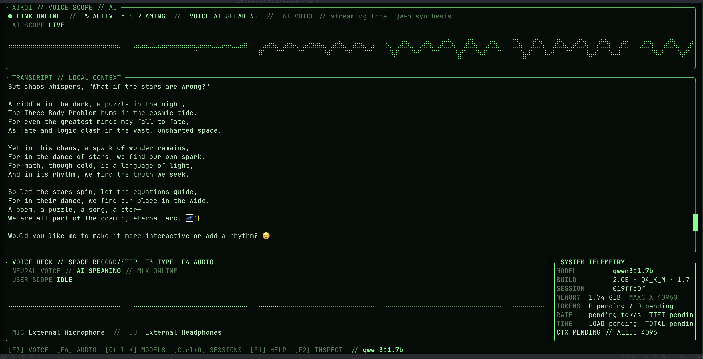

# Xikoi



Xikoi is a local-first terminal interface for talking to models served by
[Ollama](https://ollama.com) or [llama.cpp](https://github.com/ggml-org/llama.cpp),
with a native voice layer backed by
[MLX-Audio](https://github.com/Blaizzy/mlx-audio). It is written in Rust with
[Ratatui](https://ratatui.rs) and designed first for Apple Silicon Macs.

The visual thesis is a neuromancer control deck rather than a conventional
chat window: the conversation is the primary signal field, the composer is a
compact command surface, and live model telemetry stays visible beside it.
Phosphor green carries the signal over near-black panels, pale text remains
readable, and amber or crimson is reserved for warning and failure states.
Motion is restrained to meaningful activity and can be disabled. The same deck
can run as a keyboard composer or a voice console whose AI trace occupies the
top visualizer and whose user trace lives in the voice deck, both drawn as
live oscilloscopes from real microphone and synthesized-speaker PCM.

## Status

Xikoi is an early-stage application. The current contract is:

- streamed local chat through Ollama or llama.cpp;
- selection from models exposed by the selected local chat server;
- exact token and timing metrics when the backend reports them;
- push-to-talk Qwen3-ASR and streaming Qwen3-TTS through MLX-Audio;
- selection of every input and output device exposed by the host audio system;
- distinct user-speaking, transcribing, thinking, synthesizing, and AI-speaking states;
- dual oscilloscopes for live user capture in the voice deck and AI playback in the top visualizer;
- local JSONL session history and file-based diagnostics;
- responsive wide, compact, minimal, and safe too-small terminal states;
- an explicit guided setup for runtimes and model downloads;
- no analytics or external telemetry.

## Install

The complete voice experience supports Apple Silicon macOS. The Rust TUI and
text backends can also be built on Intel macOS and Linux, but voice remains a
best-effort, disabled-by-default path there.

Homebrew is the recommended end-user installation:

```sh
brew install xerexcoded/tap/xikoi
xikoi setup
xikoi doctor
xikoi
```

Rust users can install the same binary from crates.io:

```sh
cargo install --locked xikoi
xikoi setup
xikoi
```

`xikoi setup` displays one plan before changing anything. With confirmation it:

1. detects or installs Ollama and starts its local service;
2. chooses `qwen3.5:9b` on machines with at least 20 GiB of memory and
   `qwen3:1.7b` on smaller machines, unless `--model` selects another model;
3. pulls the chosen Ollama model with progress;
4. creates a private, pinned Python 3.12 MLX-Audio environment;
5. downloads the configured ASR and TTS snapshots before first use; and
6. runs real TTS-to-ASR inference to verify the complete voice path.

The expected default downloads are approximately 9.3 GB on a 24 GiB machine
or 4.1 GB on a smaller machine. Existing installations and model caches are
reused. For unattended setup, review the plan first and then use:

```sh
xikoi setup --yes
```

`xikoi setup --skip-voice` prepares chat only. `xikoi setup --skip-ollama`
prepares voice for a separately managed llama.cpp or Ollama backend. Normal
`xikoi` launches never install dependencies or download models; if setup is
incomplete, the interface stays open with a retryable offline state.

The voice runtime requires an Apple Silicon Mac. On first microphone use,
macOS asks for permission for the terminal application that launched Xikoi.
Grant or review it under **System Settings → Privacy & Security → Microphone**.

## Development environment

Contributors use Nix; Nix is not required by the Homebrew or crates.io install.
The repository pins the current `nixpkgs-unstable` revision and supports
`aarch64-darwin`, `x86_64-darwin`, `aarch64-linux`, and `x86_64-linux`.
Because Nixpkgs unstable 26.11 dropped Intel macOS, `x86_64-darwin` alone uses
the pinned, security-maintained `nixpkgs-26.05-darwin` branch.
The committed `flake.lock` locks the complete Nix toolchain and `Cargo.lock`
locks Rust dependencies. Rust, Cargo, rustfmt, Clippy, rust-analyzer, test
tools, and Nix tooling all come from the flake; a separate rustup toolchain is
neither needed nor used. A pinned `rust-overlay` input supplies the official
stable Rust toolchain, currently Rust and Cargo 1.97.1, and the Nix package
build uses that exact same compiler and Cargo.

Allow direnv once:

```sh
direnv allow
```

The installed direnv `use flake` helper enables Nix's flake commands for the
project. To enter manually on a machine where experimental features are not
enabled globally, use:

```sh
nix --extra-experimental-features 'nix-command flakes' develop
```

When using Zed, configure the workspace to load its direnv shell so the editor
sees the flake-provided `rust-analyzer` and Nix language server. Restart the
language servers from Zed's command palette after first allowing direnv.

Start Xikoi with the model picker:

```sh
cargo run
```

Or request an installed model explicitly:

```sh
cargo run -- --model qwen3:1.7b
```

The Ollama endpoint defaults to `http://127.0.0.1:11434`. Override it with
`--ollama-url`, `XIKOI_OLLAMA_URL`, or Ollama's `OLLAMA_HOST`.

## Local voice runtime

The public binary embeds the repository's Python manifest and UV lockfile.
`xikoi setup` materializes them under `~/.config/xikoi/voice-runtime`, resolves
the private environment, downloads both explicitly configured Hugging Face
snapshots, and verifies them in offline-cache mode. Normal `xikoi` runs start a
localhost-only MLX-Audio child when no compatible server is already listening,
then stop that managed child when the TUI exits.

The pinned defaults are:

- runtime: Python 3.12 with `mlx-audio==0.4.7`;
- ASR: `mlx-community/Qwen3-ASR-0.6B-8bit`;
- TTS: `mlx-community/Qwen3-TTS-12Hz-0.6B-CustomVoice-6bit`; and
- voice: `Vivian`.

Both model repositories and MLX-Audio are permissively licensed; model weights
remain in the user's normal Hugging Face cache and are not bundled with Xikoi.

For development, the Nix flake still exposes the pinned sidecar directly:

```sh
nix run .#voice-server
```

To resolve the pinned Python environment without starting the server:

```sh
nix develop .#voice --command uv sync --frozen
```

Xikoi captures with CoreAudio through CPAL, mixes the microphone to mono,
resamples it to 16 kHz, and sends an in-memory WAV to
`/v1/audio/transcriptions`. MLX-Audio streams signed 16-bit 24 kHz PCM from
`/v1/audio/speech`; Xikoi resamples and plays it through the selected output.
Raw captured audio is never saved. Voice turns are half-duplex to avoid feeding
speaker output back into ASR; press Space while the AI is speaking for manual
barge-in.

The Audio Matrix lists every microphone and output route exposed by the host.
For simultaneous playback through multiple physical devices, create a macOS
Multi-Output Device in Audio MIDI Setup and select that logical route in Xikoi.

## Keymap

| Key | Action |
| --- | --- |
| `Enter` | Send the composer contents |
| `Alt+Enter` or `Ctrl+N` | Insert a newline |
| `Esc` | Cancel generation or close the active overlay |
| `F3` | Toggle typing and neural voice modes |
| `F4` | Open the microphone/output Audio Matrix |
| `Space` in voice mode | Start/stop capture; barge in during AI speech |
| `PageUp` / `PageDown` | Scroll the conversation |
| `End` | Re-pin the viewport to the newest message |
| `Ctrl+K` | Open the model picker |
| `Ctrl+O` | Open saved sessions |
| `Ctrl+L` | Start a new session |
| `Ctrl+R` | Retry the chat and MLX-Audio connections |
| `F1` | Toggle help |
| `F2` | Open the full telemetry inspector |
| `Ctrl+C` | Persist any partial response, then quit |

The transcript auto-follows while pinned. Scrolling upward unpins it; `End`
resumes live following.

## Configuration and local storage

Configuration precedence for the Ollama endpoint is:
`--ollama-url`, `XIKOI_OLLAMA_URL`, `OLLAMA_HOST`, `config.toml`, then the
localhost default.

Other environment overrides are `XIKOI_MODEL`, `XIKOI_RESUME`,
`XIKOI_KEEP_ALIVE`, `XIKOI_COLOR`, `XIKOI_NO_ANIMATION`, and
`XIKOI_ALLOW_CLOUD_MODELS`. Voice overrides are `XIKOI_SPEECH_URL`,
`XIKOI_SPEECH_ENABLED`, `XIKOI_ASR_MODEL`, `XIKOI_TTS_MODEL`, and
`XIKOI_TTS_VOICE`. Chat-backend overrides are `XIKOI_BACKEND` and
`XIKOI_LLAMA_URL`. Command-line values take priority, followed by
Xikoi environment variables and then `config.toml`.

Xikoi follows `XDG_CONFIG_HOME` when it is set. Otherwise all application data
lives under `~/.config/xikoi`:

| Path | Purpose |
| --- | --- |
| `config.toml` | User configuration |
| `state.json` | Last model/session, voice mode, and selected audio routes |
| `chats/` | One append-safe JSONL file per session |
| `logs/` | Private per-run diagnostic logs; newest ten retained |
| `voice-runtime/` | Private pinned MLX-Audio Python environment |

Example `~/.config/xikoi/config.toml`:

```toml
backend = "ollama"
ollama_url = "http://127.0.0.1:11434"
llama_url = "http://127.0.0.1:8080"
keep_alive = "5m"
color = "auto"
animation = true
allow_cloud_models = false

[speech]
enabled = true
url = "http://127.0.0.1:8000"
asr_model = "mlx-community/Qwen3-ASR-0.6B-8bit"
tts_model = "mlx-community/Qwen3-TTS-12Hz-0.6B-CustomVoice-6bit"
tts_voice = "Vivian"
```

Useful command-line overrides:

```sh
cargo run -- --color ansi --no-animation
cargo run -- --resume <session-uuid>
cargo run -- --no-speech
xikoi setup --model qwen3:1.7b
xikoi doctor
```

Valid color modes are `auto`, `truecolor`, `ansi`, and `mono`.

### llama.cpp chat backend

Start a current llama.cpp server with a chat-capable GGUF, then select its
OpenAI-compatible endpoint:

```sh
llama-server -m /path/to/model.gguf --host 127.0.0.1 --port 8080
cargo run -- --backend llama-cpp --llama-url http://127.0.0.1:8080
```

llama.cpp is an alternate chat backend here. MLX-Audio remains the TTS runtime;
the two processes can be combined or used independently with typing mode.

## Privacy boundary

With the default localhost endpoints and local models, prompts, responses, and
speech stay between Xikoi and the local inference processes. Xikoi sends no
analytics or usage telemetry.

The guided setup connects to Homebrew, PyPI, Ollama's model registry, and
Hugging Face only for the installations and model downloads shown in its plan.
Normal inference is local and the downloaded voice snapshots are verified for
offline reuse.

Sessions are saved as plaintext JSONL under `chats/`; anyone with access to
those files can read them. Diagnostic logs can contain model names, timings,
and error details, but should not contain message bodies or raw audio. Speech
transcripts are persisted as ordinary user messages marked with `VOICE` origin.

Cloud-backed models are refused unless `allow_cloud_models = true` is set
explicitly. Pointing `ollama_url` at a remote host or enabling cloud models
means prompts leave the device and are governed by that service's policies.
The interface must visibly distinguish that state from local inference.

## Test and build

Run the standard quality gate inside the activated Nix environment:

```sh
cargo fmt --check
cargo clippy --all-targets --all-features -- -D warnings
cargo nextest run --all-features
cargo audit
cargo build --release
nix flake check
```

Build or run the flake package:

```sh
nix build
nix run . -- --model qwen3:1.7b
```

If flakes are not enabled globally, the same fallback applies:

```sh
nix --extra-experimental-features 'nix-command flakes' flake check
nix --extra-experimental-features 'nix-command flakes' build
```

Normal tests use mocked HTTP fixtures and never require Ollama, llama.cpp, or
MLX-Audio. The live smoke
test is ignored by default; opt in only after starting Ollama and choosing an
already-installed model:

```sh
OLLAMA_INTEGRATION_MODEL=qwen3:1.7b \
  cargo test --test ollama_smoke -- --ignored --nocapture
```

CI runs the Nix-defined checks on both `x86_64-linux` and native
`aarch64-darwin`. It does not start inference servers or download model weights.

## License

Xikoi is available under either the [MIT license](LICENSE-MIT) or the
[Apache License 2.0](LICENSE-APACHE), at your option.
