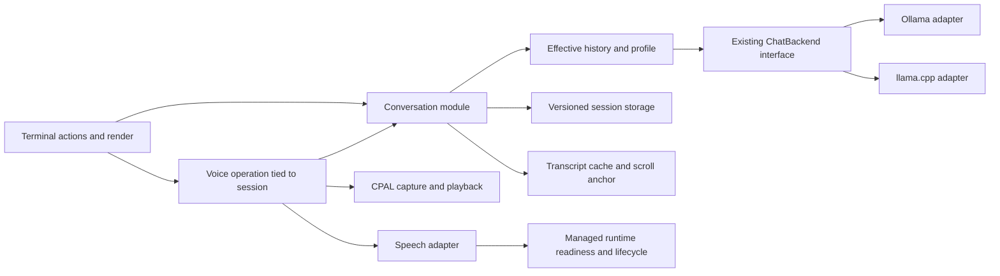

# Xikoi improvement research and roadmap

Research date: 13 October 2026. Inspected checkout: `1ea6dab207af176c3e8dd12c393bc527fc767bb1` (Xikoi 0.1.1).

I would prioritize making Xikoi a dependable, fast, visibly private local voice terminal. The best first changes are lifecycle and protocol fixes, followed by explicit context controls, faster first audio, and practical session tools. Attachments, retrieval, and tool execution are useful possible extensions, but each introduces more storage, context, and permission behavior.

This report combines source inspection with current first-party documentation, upstream source, model documentation, and comparable terminal applications. It covers chat/inference, voice/audio, terminal experience, persistence/privacy, architecture, tests, development, and distribution. It is a broad improvement inventory, not a claim to enumerate every possible change.

**Implementation update, 13 October 2026:** roadmap items 01–10 have been implemented. `cargo fmt --all -- --check`, `cargo clippy --all-targets --all-features -- -D warnings`, and `cargo test --locked --all-features` pass inside the Nix development shell. The suite reports 119 library tests and one binary test passing; the optional Ollama smoke test is ignored unless a local server and model are configured. The changed terminal snapshot contains intentional trailing padding from Ratatui's fixed-width frame, so `git diff --check` reports that one snapshot line. PTY checks, model downloads, microphone checks, and live inference benchmarks were not run.

Code findings are identified separately from performance hypotheses and product proposals. Current upstream `main`/`master` features require compatibility checks against the user's installed server. Effort estimates are relative scope, not delivery promises: S = localized; M = changes across several existing modules; L = a new workflow or substantial migration. “Now / Next / Later” expresses recommended implementation order, not vulnerability severity or implementation status.

## Preserve what already works

- Keep Rust/Ratatui, the small `ChatBackend` interface with its two real adapters, and the Nix development environment. A rewrite is not supported by these findings.
- Preserve cancellable streaming, optional exact backend metrics, bounded HTTP bodies/stream records, explicit offline states, and terminal-control sanitization. The Ollama adapter already has substantial malformed-stream, cancellation, and timeout coverage.
- Preserve private JSONL files and recovery of valid records from damaged sessions, existing terminal snapshots, responsive layouts, monochrome/ASCII fallbacks, and reduced animation.
- Preserve CPAL's bounded audio queues, chunk-safe PCM decoding, streaming resampler state, manual barge-in, and stale voice-operation checks.
- Preserve explicit setup downloads and the pinned Python environment. Extend reproducibility to model revisions and end-to-end offline verification.

Evidence: `src/backend/ollama.rs`, `src/http_limits.rs`, `src/storage.rs`, `src/ui/sanitize.rs`, `src/ui/theme.rs`, `src/audio.rs`, `src/voice_runtime.rs`, `.github/workflows/ci.yml`, and the three committed lockfiles.

## Ranked inventory

Each row points to a detailed section below. Features sharing the same prerequisite should be implemented together rather than as unrelated layers.

| ID | Change | Order | Effort | Expected benefit |
| --- | --- | --- | --- | --- |
| 01 | Bind voice work to its session and cancel it on committed switches | Now | S–M | Prevent misplaced transcripts and lingering playback |
| 02 | Preserve hydrated model capabilities | Now | S | Correct model metadata and feature gating |
| 03 | Parse llama.cpp streaming errors and make queue sends cancellable | Now | S–M | Accurate failures and responsive cancellation |
| 04 | Bound and cancel reads of streaming HTTP error bodies | Now | S | Prevent generation hanging after error headers |
| 05 | Correct raw-audio privacy documentation and sidecar behavior | Now | S / M | Align promises with the complete voice path |
| 06 | Show chat and speech route locality in every layout | Now | M | Make off-device inference visible |
| 07 | Make Ctrl+C global, including overlays | Now | S | Reliable quit behavior |
| 08 | Explicitly initialize bracketed paste and test multiline paste | Now | S | Prevent pasted newlines becoming sends |
| 09 | Anchor an unpinned transcript to message/row identity | Now | M | Keep reading position stable during streaming |
| 10 | Save and load the real backend/session configuration | Now | S–M | Correct provenance and predictable resume |
| 11 | Recover corrupt state and isolate unreadable session files | Next | M | Keep one damaged file from blocking startup |
| 12 | Define safe concurrent writes and crash-durability policy | Next | M | Reliable sessions across processes and failures |
| 13 | Build an explicit effective-history/context policy | Next | M | Predictable long conversations |
| 14 | Add model-specific thinking and generation controls | Next | M | Better speed/quality choices |
| 15 | Display optional reasoning separately from final answers | Next | M | Explain reasoning-model delays without speaking reasoning |
| 16 | Improve llama.cpp telemetry and prompt-cache metrics | Next | M | Useful diagnostics on both backends |
| 17 | Interpret stop reasons; retry, regenerate, and continue | Next | M | Recover without duplicate or misleading turns |
| 18 | Instrument voice stages and time to first audible sample | Next | S–M | Locate actual latency before tuning |
| 19 | Synthesize completed answer phrases while chat streams | Next | M–L | Earlier spoken responses |
| 20 | Recover devices and improve capture/playback buffering and resampling | Next | M | Dependable microphone/speaker operation |
| 21 | Negotiate speech capabilities and improve language/voice/speech text | Next | M | Clear compatibility and multilingual behavior |
| 22 | Pin voice model revisions and enforce managed offline inference | Next | M | Reproducible, verifiable local voice |
| 23 | Use memory-aware setup, lazy voice startup, and explicit warmup | Next | M | Better fit on constrained Macs |
| 24 | Cache transcript formatting and index session summaries | Next | M | Responsive large histories |
| 25 | Add session search, rename, export, delete, and ephemeral chats | Next | M | Make saved conversations usable and controllable |
| 26 | Add prompt profiles, prompt recall, copy actions, and a command palette | Next | M | Faster routine use and discoverability |
| 27 | Add plain/headless modes and configurable key bindings | Next | M | Shell integration and broader accessibility |
| 28 | Add PTY, lifecycle, protocol-property, and optional real-backend tests | Next | M | Verify behavior that snapshots cannot cover |
| 29 | Validate UV locks, crate packaging, release installation, and platform claims | Next | S–M | Reduce release regressions |
| 30 | Pin workflow actions and publish artifact provenance | Next | S–M | Make release inputs and outputs verifiable |
| 31 | Deepen conversation, voice, transcript, and runtime modules incrementally | Next | M | Concentrate invariants and simplify testing |
| 32 | Migrate configuration/state/data paths with backward compatibility | Later | M | Clear backup/cache responsibilities |
| 33 | Add explicit text and image attachments | Later | M–L | Local file and image conversations |
| 34 | Add schema-validated output and JSON/headless export | Later | M | Repeatable extraction and scripting |
| 35 | Add retrieval over explicitly selected local documents | Later | L | Document Q&A with inspectable sources |
| 36 | Evaluate VAD and incremental ASR; retain push-to-talk | Later | L | More natural interaction if measurements justify it |
| 37 | Add authenticated compatible servers or alternative voice runtimes on demand | Later | M–L | Support actual hardware/server requirements |
| 38 | Add constrained tools/MCP only as an explicit product direction | Later | L | Extend capability with a defined execution policy |

## A. Correct lifecycle and protocol behavior first

### 01. Voice work can cross session changes

**Code finding.** `src/app.rs:1513–1553` replaces the active session while checking only `generation_cancel`. Recording, transcription, and playback can be active without chat generation. A later transcription checks only `voice_operation_id` at `:745`, then sends into the current session at `:753`. A session switch does not invalidate that operation. Thus an old recording can become a user message in the new session. The recording/playback handles also survive those switches.

Cancel/invalidate voice work when committing a session change, and carry session identity in asynchronous events. Apply a defined policy to model changes too. Inject pending events in tests: start an operation, switch session, deliver its transcription/TTS event, and assert that neither the new session nor playback changes. This does not require a microphone or model weights.

### 02. Detailed model capabilities are overwritten

**Code finding.** `src/backend/ollama.rs:285–300` reads `/api/show` capabilities; `src/app.rs:701–703` replaces the entire detailed summary with `/api/tags` data. Existing `tags.json` omits capabilities while `show.json` contains them. Merge fields without discarding richer show metadata. Treat absent capabilities as unknown, hydrate the selected model first, and disable known-incompatible actions. Ollama exposes capabilities through its [show-model endpoint](https://docs.ollama.com/api/show).

Validate list/show disagreement, omitted older-server fields, embedding-only models, cloud metadata, and hydration completing after model selection changes. Do not fetch full metadata for every model on every frame.

### 03–04. Close streaming error and cancellation gaps

**Code findings.** `src/backend/llama_cpp.rs:320–349,454–459` ignores streamed error envelopes and awaits bounded-channel sends without a cancellation select. Current upstream emits errors after a streaming response has begun; losing the explanation produces a generic premature-EOF failure. A full queue can delay cancellation. The Ollama adapter already provides a cancellation-aware emitter to model this on. See [llama.cpp's streaming implementation](https://github.com/ggml-org/llama.cpp/blob/master/tools/server/server-context.cpp) and [Tokio bounded send behavior](https://docs.rs/tokio/latest/tokio/sync/mpsc/struct.Sender.html#method.send).

Both adapters also leave their cancellation select before reading non-success response bodies (`ollama.rs:325–330`, `llama_cpp.rs:180–185`). Those reads have size caps, but the streaming request's error-body branch lacks a read deadline. Handle cancellation and a short deadline there. Separately define generous loading/first-response and stream-idle budgets, with a visible stalled state. A short metadata timeout should not become a cap on legitimate inference; reqwest distinguishes [total and read timeouts](https://docs.rs/reqwest/latest/reqwest/struct.ClientBuilder.html#method.read_timeout).

Validate streamed errors after partial content, stalled error bodies, queue saturation, consumer disconnect, cancellation during dispatch/body/delivery, absent usage, fragmented UTF-8, and early EOF. Extend generic SSE parsing only when broader compatible-server support needs it; [WHATWG SSE](https://html.spec.whatwg.org/multipage/server-sent-events.html#parsing-an-event-stream) permits forms beyond current llama.cpp output.

Speech has an overall request timeout, but its post-header transcription/error-body reads wait before rechecking cancellation (`src/speech.rs:125–133,:174–184`). Make those awaits cancellation-aware too, and distinguish user cancellation from a transport failure. This is a cancellation-delay gap, not an assertion that speech requests have no deadline.

## B. Make privacy promises and storage behavior precise

### 05. Raw audio is transiently written by the pinned sidecar

**Source-backed documentation mismatch.** Xikoi builds its WAV in memory (`src/audio.rs:404–421`), but pinned MLX-Audio v0.4.7's `STTExecutionAdapter` writes received audio under `/tmp` and removes it in `finally` ([pinned server source, lines 259–303](https://github.com/Blaizzy/mlx-audio/blob/v0.4.7/mlx_audio/server.py#L259)). The README's “Raw captured audio is never saved” is broader than the end-to-end implementation supports. Normal cleanup is not proof of cleanup after forced termination.

Immediately document transient sidecar files and their lifecycle. If never writing audio is the intended product guarantee, use an in-memory inference adapter and verify every capture-to-ASR path. Otherwise use private temporary storage, restrictive permissions, and tested cleanup. Verify the distributed Python package's path as well as upstream tagged source; this research did not run it locally.

### 06. Privacy status must follow each configured route

The picker labels model metadata CLOUD/LOCAL (`src/ui/render.rs:808`), but transcript and empty-state text always claim local context (`:312,:946`). A remote-hosted local model is still off-device inference. Speech accepts configured URLs; `spawn_managed` probes a pre-existing endpoint before restricting a child launch to loopback (`src/voice_runtime.rs:172–176`). The managed-child restriction therefore does not establish that all speech requests are local.

Introduce one endpoint classification module for loopback, LAN/remote, cloud-backed model, and unknown. Show chat and speech route status in wide, compact, and minimal layouts; replace unconditional LOCAL labels. Make remote speech behavior explicit in configuration/help, and redact URL credentials from displayed/logged endpoints. A loopback proxy cannot prove where inference ultimately runs: show known route facts and unknowns honestly. Validate IPv4/IPv6 loopback, localhost, remote speech, cloud models, and mixed chat/speech routes.

### 10–12. Improve session provenance, recovery, and durability

**Code finding:** session headers always store `backend: "ollama"` (`src/storage.rs:101`), and the loader discards that field (`:241`). Accept the actual backend on creation and restore or visibly reconcile backend/model/profile differences. Store effective generation settings and future model revisions with provenance; keep old records readable.

**Resilience proposal:** corrupted `state.json` errors propagate through bootstrap (`storage.rs:183–190`, `app.rs:148`), and one session I/O error can abort listing (`storage.rs:160–165`). Preserve bad files for recovery, fall back to usable state, and show per-session failures. A transient disk-write failure should retain the unsaved response and offer export/retry instead of losing the terminal session.

**Concurrency risk:** every process uses `state.json.tmp` (`storage.rs:193–197`), and separate launches can resume the same recent chat. Use uniquely created temporary files and an explicit single-writer lock/conflict policy. Atomic rename alone does not coordinate competing writers; Rust provides [file-locking operations](https://doc.rust-lang.org/std/fs/struct.File.html#method.try_lock).

**Durability proposal:** `flush` completes pending writes but does not guarantee stable-storage persistence. Choose an explicit `sync_data`/`sync_all` policy at meaningful checkpoints, recognizing latency and platform tradeoffs ([Tokio file documentation](https://docs.rs/tokio/latest/tokio/fs/struct.File.html)). If crash recovery should retain partial answers, introduce versioned checkpoint/update records keyed by message ID; repeatedly appending partial messages to the current schema would duplicate transcript entries. Test concurrent launches, disk full, permission loss, interrupted replacement, malformed state, old schema, and recovery without modifying the original damaged file.

## C. Make text chat predictable and useful

### 13. Separate stored history from effective inference history

`src/app.rs:988–997` sends the complete session, including failed/cancelled assistants. Its context warning occurs after completion (`:827–851`). Build a context policy that preserves instructions, complete turns, newest input, and an output reserve while leaving original history intact. Provide visible choices for dropping old turns, starting a new session, or creating a marked summary. Do not silently summarize or treat a failed empty assistant as a completed turn.

Ollama's current [prompt implementation](https://github.com/ollama/ollama/blob/main/server/prompt.go) can truncate history. Its [context guidance](https://docs.ollama.com/context-length) should inform defaults, but actual allocated context is the authority. Current llama.cpp documents [chat input-token counting](https://github.com/ggml-org/llama.cpp/blob/master/tools/server/README.md#post-v1chatcompletionsinput_tokens-token-counting). Feature-detect it; label heuristic estimates as estimates. Show last-turn occupancy separately from next-turn estimates, and allocated capacity separately from the advertised maximum. Test small windows, oversized newest input, multilingual/code prompts, output reserve, absent counters, and switching to a smaller model.

### 14–15. Add modest controls and optional reasoning visibility

`GenerationOptions` exposes only `keep_alive` (`src/domain.rs:188–190`). Both adapters already produce `ThinkingDelta`, but the app discards the text (`src/app.rs:820–825`). Add system instructions, output/context limits, temperature, seed, and a small set of named profiles. Thinking settings must come from model/server capability, with Auto as the fallback; supported controls vary by model ([Ollama thinking](https://docs.ollama.com/capabilities/thinking), [llama.cpp chat parameters](https://github.com/ggml-org/llama.cpp/blob/master/tools/server/README.md#post-v1chatcompletions-openai-compatible-chat-completions-api)).

Offer a collapsible reasoning view and an explicit persistence preference. Keep reasoning out of TTS. Xikoi's current TTFT measures the first content delta, not first reasoning; label it first-answer latency and optionally add first-any-token and thinking duration. Test boolean/level controls, unset defaults, unsupported choices, reasoning-only responses, interleaving, resume, and final-answer-only speech.

### 16–17. Telemetry and recovery should explain what happened

The llama.cpp adapter currently returns no running-model metadata and hydrates little beyond names (`src/backend/llama_cpp.rs:126–158`). Read optional context/model/build fields and final timing data with graceful fallbacks ([server reference](https://github.com/ggml-org/llama.cpp/blob/master/tools/server/README.md), [result serialization](https://github.com/ggml-org/llama.cpp/blob/master/tools/server/server-task.cpp)). Ollama's [chat endpoint](https://docs.ollama.com/api/chat) also exposes prompt-cache counts; surface cached versus uncached processing when reported. Never invent missing counts or treat global server counters as one turn's measurements.

`Finished` always becomes Complete/LINK COMPLETE (`src/app.rs:827–856`). Interpret length stops and other finish reasons; offer retry without duplicating the user turn, regenerate, and continue. Retain alternatives as versions/branches. Avoid automatic retries after partial output: another POST starts another generation. Test missing/zero metrics, unit conversion, final usage-only chunks, output limits, empty final output, and retries using the original effective settings.

## D. Improve voice responsiveness through measurement

### 18–19. Measure first audio, then pipeline synthesis

TTS is streaming, but it starts only after `ChatEvent::Finished` (`src/app.rs:839–855`), so the user waits for the entire answer before synthesis. Measure capture end → transcription complete → first final-answer text → first PCM → first audible sample, plus total duration, cold/warm state, queue underruns, and cancellation latency. Existing chat tok/s does not measure voice responsiveness.

Then experiment with a bounded ordered queue of complete sentences/phrases from final-answer deltas. Preserve sentence order, avoid speaking reasoning/code/URLs by default, and cancel the queue with the originating operation. Compare phrase length and TTS streaming interval for first audio, continuity, prosody, and underruns. The [Qwen3-TTS project](https://github.com/QwenLM/Qwen3-TTS) describes streaming capability; that does not establish end-to-end Xikoi latency or guarantee a particular improvement.

### 20–23. Audio/runtime reliability and reproducibility

Treat device disconnection, unsupported formats, capture overflow, and playback underflow as actionable states. `has_problem()` combines queue pressure and stream failure (`src/audio.rs:237–239,:379–380`), while the UI calls both buffer pressure (`src/app.rs:886–913`). Preserve distinct failure categories, route-fallback notices, and retry/route selection. Finalize the capped 120-second recording explicitly instead of continuing to show live capture while dropping samples. Keep allocations, locks, and expensive work outside CPAL callbacks; use [CPAL's documented stream/error model](https://docs.rs/cpal/latest/cpal/).

Playback currently drops samples on overflow and inserts silence when empty. Add a small prebuffer, queued-duration high/low-water marks, underrun/dropped-sample counters, and bounded backpressure before dropping audio. Include event-channel bytes in total memory accounting and bound setup warm-up's full-response read (`src/setup.rs:392`). Test empty PCM, an odd final byte, unexpected content type, sample ordering, and faster/slower-than-playback arrival. Queue emptiness alone may precede hardware playback completion (`src/app.rs:918–929`); investigate final-audio drain behavior with hardware before calling it a clipping defect.

Microphone conversion uses linear interpolation without a low-pass filter (`src/audio.rs:646–670`). At 48 kHz → 16 kHz it selects every third sample, permitting out-of-band energy to alias. Compare a band-limited resampler with tone/sweep fixtures and speech recognition quality ([Rubato's filter/CPU tradeoffs](https://docs.rs/rubato/latest/rubato/index.html)). Do not claim an ASR accuracy gain until measured. Also benchmark maximum-duration resampling/WAV encoding on the app event path (`src/app.rs:1280`); move it to a worker if it causes input stalls.

Replace a generic successful speech-root probe with capability/readiness checks where supported. Do not equate server reachable, model cached, model loaded, and inference verified. Validate the chosen ASR/TTS models, available voices/languages, response format/sample rate, empty PCM, and timeouts. The present client assumes Qwen's 24 kHz PCM and a fixed voice (`src/speech.rs:46–58`, `src/audio.rs`); expose supported language/voice controls with graceful fallback.

Add a small voice preview and optional ASR-language preference. Parse Markdown into speech-friendly prose: `text_for_speech` currently strips a handful of punctuation characters (`src/app.rs:1603–1621`), so code, links, and tables can be read awkwardly. Offer an explicit policy for code/URLs/tables, cap automatic spoken length, and consider a transcript review step before ASR text is sent. Strengthen setup's TTS→ASR check with normalized expected-phrase similarity; today's nonempty transcription proves both processes returned output, not semantic round-trip accuracy.

The embedded package lock pins Python dependencies, but model downloads omit `revision` (`src/voice_runtime.rs:25–50`). Record a full revision and the snapshot actually used, and ensure inference loads it. Hugging Face supports [revision-pinned snapshots](https://huggingface.co/docs/huggingface_hub/guides/download). The managed child sets telemetry suppression but does not set `HF_HUB_OFFLINE` (`voice_runtime.rs:276–287`); explicitly enforce offline operation after setup and test with network denied ([Hub environment variables](https://huggingface.co/docs/huggingface_hub/package_reference/environment_variables)). Cache presence alone is insufficient proof.

Add setup disk-space and memory headroom checks for chat + ASR + TTS + context, rather than choosing solely from total RAM. Consider lazy sidecar start when voice is activated, explicit warmup/release actions, and a progress state while loading. Ollama supports [preload and keep-alive controls](https://docs.ollama.com/faq#how-can-i-preload-a-model-into-ollama-to-get-faster-response-times); changing server-wide cache/parallelism settings can affect other clients. Benchmark a fixed suite before changing model defaults, context sizes, quantization, or residency. No speedup percentages are justified by this research.

## E. Improve terminal experience and session workflows

### 07–09. Fix input and reading behavior

**Ctrl+C:** `src/app.rs:516–519` routes keys into overlays before global handling; `handle_overlay_key` has no quit branch. Put emergency quit above overlay routing. Test help/model/session/audio overlays in a PTY, including persistence and restoration.

**Bracketed paste:** there is a handler (`app.rs:505`) but no explicit enable/disable command in the repository. Crossterm emits Paste only when [bracketed paste is enabled](https://docs.rs/crossterm/0.29.0/crossterm/event/enum.Event.html#variant.Paste); Ratatui's inspected [initialization source](https://github.com/ratatui/ratatui/blob/d1ef782b48ddf0cb825c111d4d8b9adef572c0e1/ratatui/src/init.rs) enables raw mode/alternate screen rather than that protocol. Treat this as a strongly supported initialization gap requiring verification against the resolved library and a real PTY. Explicitly pair [enable/disable paste commands](https://docs.rs/crossterm/0.29.0/crossterm/event/struct.EnableBracketedPaste.html), restore them on error/panic, and assert that a pasted multiline prompt remains unsent until Enter.

**Scroll anchoring:** `TranscriptScroll::resolved` calculates from current tail length (`src/ui/mod.rs:153–159`). With 100 rows, 20 visible, and offset 8, its start is 72; adding 10 rows changes start to 82 even while unpinned. Anchor to message ID and intra-message row, accounting for resize/reflow, instead of a fixed tail distance. Test streaming growth and window resize while reading older content.

### 24. Reduce repeated work before adding UI complexity

Every transcript draw reparses every message, wraps every line, then selects visible rows (`src/ui/render.rs:333–349`). Ratatui's [buffer diffing](https://ratatui.rs/concepts/rendering/under-the-hood/) reduces terminal writes; it does not remove this application-side formatting cost. Cache completed messages by message revision/theme/width, invalidate only the active answer and changed layout, and coalesce deltas into bounded redraw intervals while persisting full text. Avoid premature incremental Markdown parsing that changes formatting semantics at chunk boundaries.

`Storage::list_sessions` reads and parses every entire JSONL file (`src/storage.rs:147–180,:212`). Keep JSONL as the authoritative source and start with a rebuildable metadata index plus background loading/pagination. Add SQLite only if measured search/index requirements justify it. Benchmark 10/100/1,000 sessions and long multilingual/code-heavy transcripts; record frame p50/p95, allocations, input latency, and idle CPU. Current code structure suggests repeated work, not a measured slowdown.

### 25–27. Make the terminal useful beyond sending messages

Add search/filter by session name/content/model, rename, Markdown/JSON export, explicit delete, ephemeral chats, copy-message/code actions, prompt recall, and a command palette with configurable bindings. Preserve original messages when editing/forking; show branch provenance. A transcript preview and export are useful before introducing a full conversation tree.

[oterm's maintained commands](https://ggozad.github.io/oterm/commands/) provide first-party examples of search, export, rename, regeneration, copy, and prompt history. [AIChat's command guide](https://github.com/sigoden/aichat/wiki/Command-Line-Guide) demonstrates profiles, file input, single-shot operation, and piping. These are workflow precedents, not evidence of user demand for every feature.

Offer an explicit headless/plain transcript mode with clean stdout, diagnostics on stderr, defined exit codes, and no automatic voice startup. This can support scripts and provide a simpler surface for screen-reader testing; actual accessibility still needs testing with users/tools. Existing NO_COLOR, ASCII, and reduced-motion handling should stay. Consider a selectable plain/high-contrast theme, expandable composer, safe link display, and optional syntax highlighting. Generate static shell completions from Clap ([clap_complete](https://docs.rs/clap_complete/latest/clap_complete/)); keep dynamic model lookup out of ordinary Tab completion unless cached and bounded. Mouse capture should be optional so ordinary text selection remains usable.

## F. Strengthen tests, releases, and module interfaces

### 28–30. Test the delivered application

Keep current fixtures/snapshots and add a small PTY suite for startup offline, paste, overlay quit, resize, cancellation, signals, and terminal restoration. Ratatui explicitly distinguishes [in-process snapshots from whole-application PTY tests](https://ratatui.rs/recipes/testing/snapshots/). Add fake child-process readiness/cleanup tests, SIGTERM/SIGHUP handling where appropriate, and optional real llama.cpp/voice smoke tests in controlled environments. A pure setup plan with a narrow executor can test decline, skipped phases, reused installations, partial failure, and retry without installing anything; current setup tests mostly cover memory tiers and loopback helpers (`src/setup.rs:536` onward). Do not make ordinary CI download model weights.

Property-based/fuzz tests can target fragmented NDJSON/SSE, arbitrary Unicode wrapping/sanitization, malformed sessions, and PCM chunk partitions. Test invariants such as bounded buffers, preserved message order, one terminal event, and no stale operation effects; avoid tests that merely mirror private functions. Maintain a pinned fixture/version matrix for backend and speech compatibility.

CI currently builds on `x86_64-linux` and `aarch64-darwin`; four declared flake systems are evaluated, but evaluation does not prove builds on Intel macOS/ARM Linux (`.github/workflows/ci.yml`). Add scheduled native builds where practical or qualify support accurately. Preserve the portable release's non-system dynamic-library check rather than assume the Nix package is an end-user portable binary.

Add `nix develop .#voice --command uv lock --check`: `--frozen` deliberately skips lock freshness verification ([UV locking semantics](https://docs.astral.sh/uv/concepts/projects/sync/)). CI currently audits Cargo only; audit a pinned/hashed requirements export of the Python lock using Nix-provided [PyPA pip-audit](https://pypi.org/project/pip-audit/), preserving Apple Silicon markers so a Linux job does not inspect an empty MLX graph. Do not imply direct `uv.lock` support or a demonstrated present vulnerability. Add `--locked` to shell CI Clippy/nextest commands to refuse unintended re-resolution ([Cargo's locked option](https://doc.rust-lang.org/cargo/commands/cargo-test.html#manifest-options)).

Run crate packaging verification because embedded `pyproject.toml`/`uv.lock` must survive the package include rules ([Cargo package](https://doc.rust-lang.org/cargo/commands/cargo-package.html)). Validate tag/manifest/changelog/runtime versions, clean-install `--help`/`--version`/offline startup, and GitHub/Homebrew/crates channel parity. Release notes should use the curated changelog. Investigate binary caching first: historical 13 August CI took 13m24s on macOS, including 6m49s for the flake/package step ([job metadata](https://api.github.com/repos/xerexcoded/xikoi/actions/runs/31725947417/jobs)). These are historical observations, not current timings. Measure warm/cold runs before adding another build framework; source filtering must retain the embedded Python files and fixtures.

Workflow action inputs currently use mutable tags. Pin reviewed full SHAs, retain readable version comments and an update mechanism, and scope release permissions to the publishing job ([GitHub secure-use guidance](https://docs.github.com/en/actions/reference/security/secure-use)). Add release attestations and immutable releases when appropriate; checksums show byte integrity while [artifact attestations](https://docs.github.com/en/actions/how-tos/secure-your-work/use-artifact-attestations/use-artifact-attestations) record build provenance. These are release guardrails, not evidence that the current release is compromised.

### 31. Concentrate invariants in a few deep modules

`App` owns conversation, overlays, persistence, telemetry, capture, playback, async task dispatch, and voice state (`src/app.rs`, 2,154 lines including tests). Size alone is not a defect. The session-switch gap is concrete evidence that related invariants are spread across handlers.

Retain one terminal-state owner while moving meaningful behavior behind small interfaces: a conversation module constructs history and commits/retries turns; a voice module owns one operation/session and cancels capture/transcription/synthesis/playback together; a transcript module owns caches and stable scroll anchors; runtime management owns readiness/installation/lifecycle. Reuse the existing two-backend seam. Introduce internal audio/process seams where a real implementation and deterministic fake improve lifecycle testing; do not add pass-through traits for every function or build a plugin system in anticipation of future needs.

This is a proposed ownership arrangement, not a required rewrite. Test behavior through the same interfaces callers use. Changes should delete repeated caller-side knowledge rather than add another forwarding layer.

## G. Extensions that should follow the foundations

**32. Paths and backup policy.** `AppPaths` puts configuration, sessions, logs, state, and runtime beneath `XDG_CONFIG_HOME` (`src/config.rs:173–193`). It accepts empty/relative values without validation. The [XDG specification](https://specifications.freedesktop.org/basedir/0.8/) requires absolute paths and distinguishes config/data/state/cache. First handle invalid environment values; later introduce a migration with original-path discovery and rollback. Keep configuration in config, valuable exported/history data in data, transient state/logs in state, and regenerable caches in cache. Document exactly what to back up and preserve user data during upgrades.

**33. Attachments.** Start with opted-in text files and PNG/JPEG images, visible size/type/inclusion previews, capability checks, context limits, and immutable copies/references with digests. Current messages contain only strings. Ollama documents [vision request encoding](https://docs.ollama.com/capabilities/vision); llama.cpp supports [multimodal input with compatible models](https://github.com/ggml-org/llama.cpp/tree/master/tools/mtmd). Test changed/deleted files, unsupported models, oversized payloads, export, and resumed sessions before recursive directory ingestion.

**34. Structured output.** Accept an optional JSON schema, validate completed output, and keep invalid/truncated original answers inspectable. Combine it with headless input/output. Ollama documents [structured output](https://docs.ollama.com/capabilities/structured-outputs), but support varies by backend/model/cloud mode. Schema validity is not factual correctness.

**35. Retrieval.** Index explicitly chosen local documents and return bounded chunks with filename/location references, deletion, and embedding-model/index versions. Start with text attachments and a small known-answer evaluation set. [Ollama embeddings](https://docs.ollama.com/api/embed) and [AIChat's retrieval guide](https://github.com/sigoden/aichat/wiki/RAG-Guide) establish available building blocks. They do not establish that retrieval improves this project's actual workloads. Avoid adding a vector service until a local index proves insufficient.

**36. VAD/incremental ASR.** Preserve push-to-talk as a predictable mode. Evaluate silence endpointing, a transcript review step, and incremental ASR before hands-free/full-duplex operation. File-upload response streaming is different from processing live microphone input incrementally. Pinned MLX-Audio has realtime routes, but model capabilities must also support the chosen protocol ([MLX-Audio project](https://github.com/Blaizzy/mlx-audio), [Qwen3-ASR](https://github.com/QwenLM/Qwen3-ASR)). Full-duplex speakers require echo handling and measured false interruptions; wake words are a separate always-listening product decision.

**37. Broader runtimes/servers.** A compatible HTTP adapter, authenticated LAN endpoint, LM Studio/vLLM support, or Linux voice can be useful when requested. Define actual endpoint contracts, secret references, TLS verification, latency/cancellation behavior, and route labels; keep Ollama's native metadata. llama.cpp supports authentication in its [server reference](https://github.com/ggml-org/llama.cpp/blob/master/tools/server/README.md). A generic “OpenAI-compatible” label does not imply identical feature support. Avoid promising cross-platform voice before hardware tests.

**38. Tools/MCP.** Current Role/messages/events cannot represent tool calls/results. Add a versioned schema and capability support before a tool loop. If this direction is chosen, begin with read-only, bounded tools, validated arguments, visible invocation, timeouts, cancellation, iteration limits, and persisted call/result pairing ([Ollama tool calling](https://docs.ollama.com/capabilities/tool-calling), [llama.cpp function calling](https://github.com/ggml-org/llama.cpp/blob/master/docs/function-calling.md)). A model request is not authorization for arbitrary shell commands or writes. This is a larger product scope, not a prerequisite for a good local chat/voice terminal.

## Suggested implementation sequence and success criteria

1. **Correctness/privacy patch:** IDs 01–10, with focused deterministic regression tests and a small PTY verification. Success: voice events cannot alter another session, Esc/Ctrl+C remain reliable, metadata survives hydration, paste cannot submit itself, reading anchors stay stable, and privacy labels/documentation match actual routes and storage.
2. **Predictable text chat:** context policy, profiles/thinking controls, stop reasons/retry, and richer telemetry (13–17), plus safe storage recovery. Success: oversize/length-stop behavior is explicit, retries avoid duplicate turns, resume uses a defined profile, and optional metrics remain honestly unknown when absent.
3. **Measured voice improvement:** stage instrumentation, device recovery, pinned/offline readiness (18,20–23), then phrase synthesis (19). Success: compare cold/warm p50/p95 first-audio latency and underruns on representative hardware; set numeric targets from the baseline rather than invent them here.
4. **Daily usability and delivery:** transcript/index performance, session/prompt tools, accessible/plain mode, and stronger release validation (24–31). Success: bounded input/render latency on a fixed long-history corpus and clean-install/offline PTY flows across claimed platforms.
5. **Selective expansion:** paths/attachments/structured output first; retrieval, VAD, additional runtimes, and tools only after their usefulness and operating cost are demonstrated.

Future development and validation should use the existing Nix flake. Keep performance measurements local and opt-in; preserve the no-analytics default. This research creates documentation only and does not create a new project or environment.

## Deliberately deferred

- A wholesale framework rewrite, generic plugin architecture, autonomous shell agent, cloud-first provider matrix, multi-user infrastructure, and mandatory vector database.
- Automatic dependency/default-model upgrades based on novelty alone. The project already uses modern dependencies; benchmark quality, compatibility, memory, and voice responsiveness before choosing replacements.
- Silent context trimming/summarization, automatic retries after partial generation, undisclosed reasoning retention, and automatic downloads during normal startup.
- Unmeasured speedup claims, universal thinking/context settings, automatic server-wide tuning, and claimed device/offline/accessibility guarantees without end-to-end verification.
